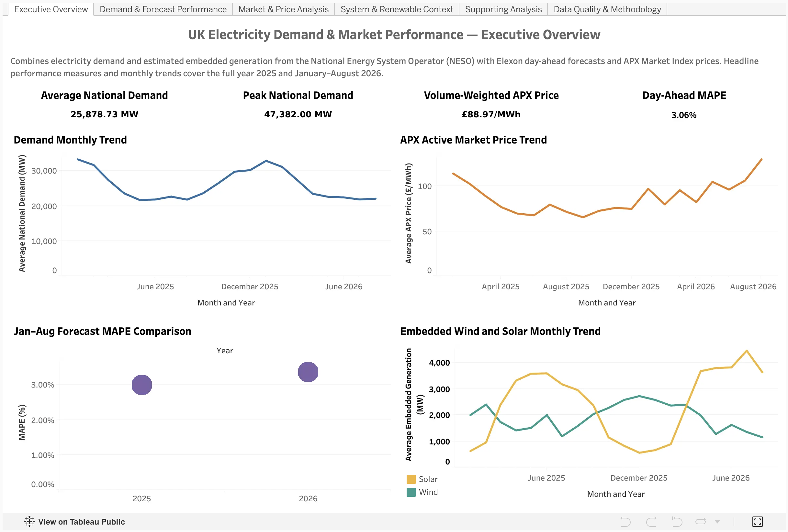
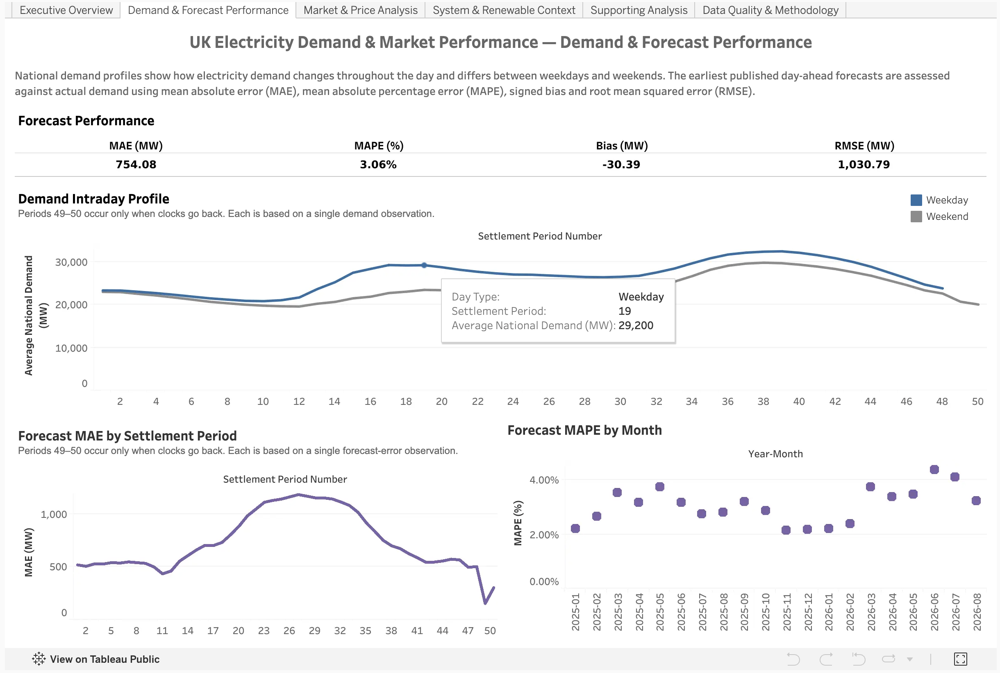
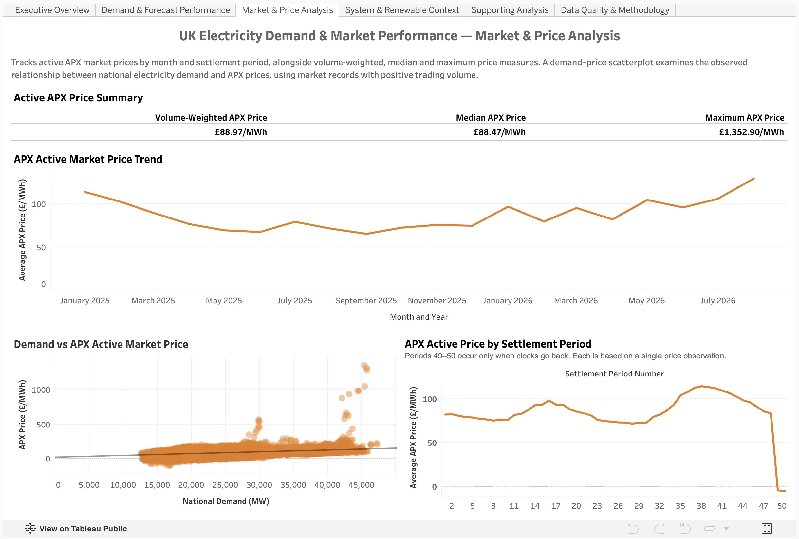
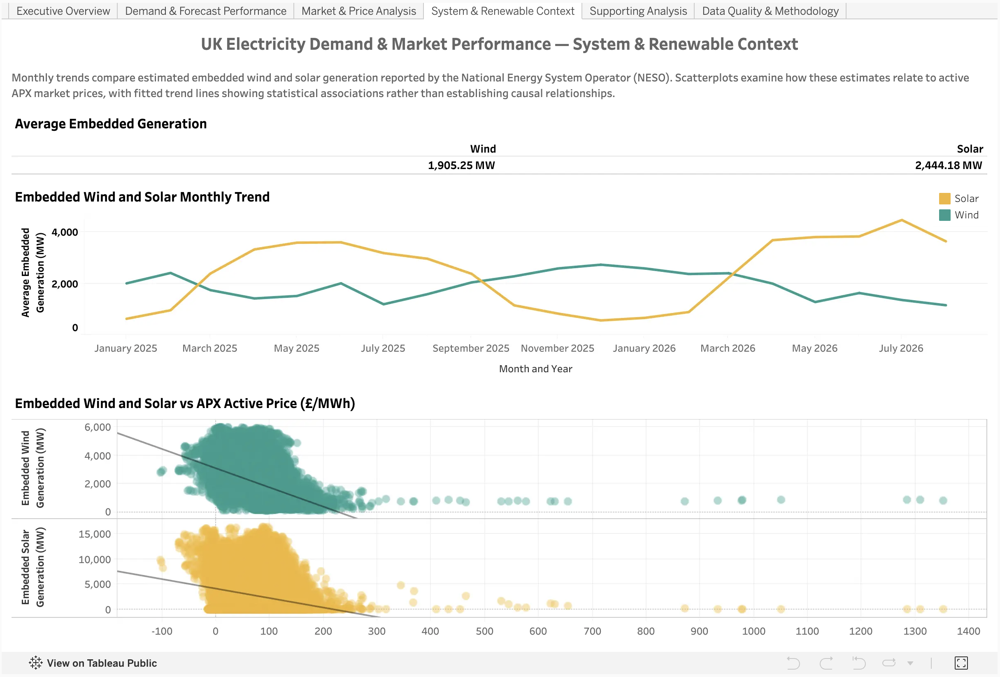
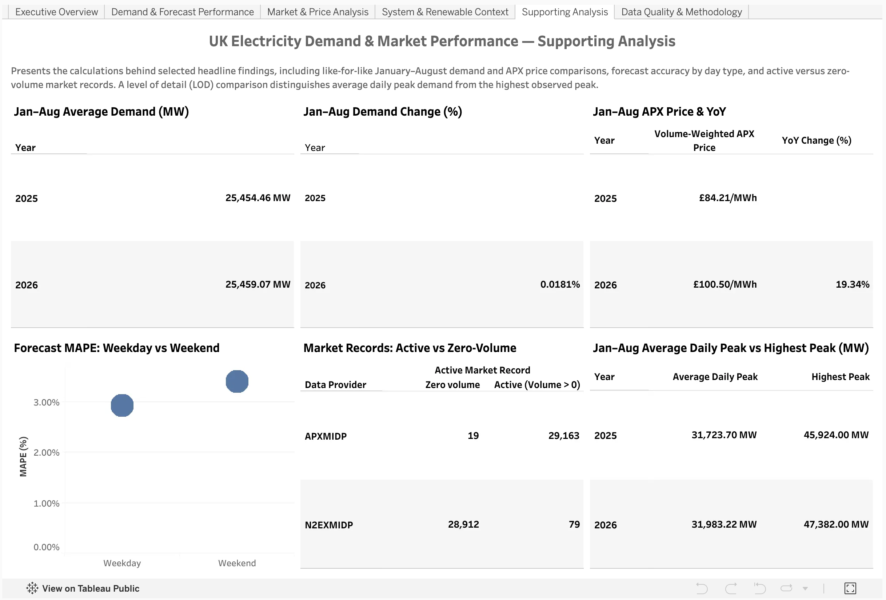
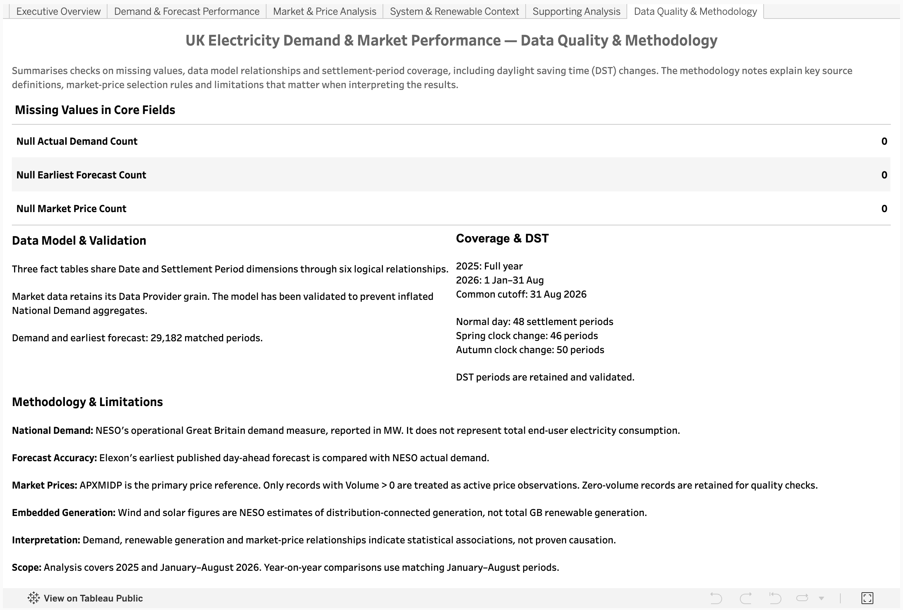

# UK Electricity Demand & Market Performance

**Six interactive Tableau dashboards | Great Britain | January 2025–August 2026**

I built this project to explore three questions: how electricity demand changes over time, how accurately day-ahead forecasts predict that demand, and how demand and estimated renewable generation relate to market prices. It brings together NESO demand data and Elexon forecast and Market Index data in six interactive Tableau dashboards.

**[Explore the live dashboards on Tableau Public](https://public.tableau.com/app/profile/yasin.yalcin/viz/UKElectricityDemandMarketPerformance2025FullYearJanAug2026/ExecutiveOverview)**

The analysis covers **all of 2025 and January–August 2026**. Year-on-year results compare **January–August in both years**, rather than comparing twelve months with eight. This is a historical analysis, not a live market monitor.

## Key findings

- **APX prices increased despite little change in average demand.** The volume-weighted price for active APXMIDP observations rose from **£84.21/MWh** in January–August 2025 to **£100.50/MWh** in January–August 2026 (**+19.3%**). Average National Demand barely moved: **25,454.46 MW** versus **25,459.07 MW** (**+0.02%**). This comparison does not explain what drove the price increase.
- **Day-ahead forecast accuracy weakened in the 2026 comparison period.** Mean absolute percentage error (MAPE) increased from **2.99%** to **3.36%**, a rise of about **0.36 percentage points**.
- **Forecast accuracy varies by time of day and day type.** Mean absolute error (MAE) peaks around **Settlement Period 27**, at approximately **1,181 MW**. Across the full dataset, MAPE is **2.92% on weekdays** and **3.40% on weekends**. These patterns do not identify the causes of forecast errors.
- **Demand and APX prices show a positive but limited association.** The Demand–APX scatterplot has a positive fitted trend, with **R² ≈ 0.157**. Demand alone accounts for only a small share of the observed price variation in that simple model.
- **Embedded wind and solar have different relationships with APX prices.** Both show negative associations in the retained data, stronger for estimated embedded wind (**R² ≈ 0.186**) than solar (**R² ≈ 0.044**). These are descriptive relationships, not evidence of a causal effect on prices.
- **Unusual periods need context.** The highest active APX price in the dataset is **£1,352.90/MWh** (8 January 2025). Settlement Periods 49–50 appear only on the autumn clock-change day, so each has just one observation here. They should not be interpreted as typical intraday averages.

## The six dashboards

| Dashboard | What to look for |
| --- | --- |
| **Executive Overview** | Headline demand, price and forecast metrics, plus the wider monthly picture. |
| **Demand & Forecast Performance** | Demand patterns by day type and half-hour; forecast errors by settlement period and month. |
| **Market & Price Analysis** | APX price trends, intraday prices and the demand–price relationship. |
| **System & Renewable Context** | Estimated embedded wind and solar generation, alongside their relationships with APX prices. |
| **Supporting Analysis** | Like-for-like demand and APX price comparisons, forecast MAPE by day type, active-market records and daily-peak demand checks. |
| **Data Quality & Methodology** | Data coverage, validation checks, model structure and interpretation notes. |

Two charts support linked selections: click a settlement period in the forecast MAE chart to filter the monthly MAPE view, or click a month in the APX price trend to filter the Demand–APX scatterplot. The other KPI panels are not changed by those selections.

### Dashboard previews

**Executive Overview**

[](images/executive-overview.png)

| Demand & Forecast Performance | Market & Price Analysis |
| --- | --- |
| [](images/demand-forecast.png) | [](images/market-price.png) |

| System & Renewable Context | Supporting Analysis |
| --- | --- |
| [](images/system-renewables.png) | [](images/supporting-analysis.png) |

**Data Quality & Methodology**

[](images/data-quality.png)

## Data and approach

The project uses the following published datasets:

| Publisher and dataset | Purpose | Source |
| --- | --- | --- |
| NESO — Historic Demand Data | National Demand and estimated embedded wind/solar | [Dataset](https://www.neso.energy/data-portal/historic-demand-data) |
| NESO — Daily Demand Update | Additional actual demand records at the end of August 2026 | [Dataset](https://www.neso.energy/data-portal/daily-demand-update/demand_data_update) |
| Elexon — Earliest Day-Ahead Demand Forecast | Earliest published National Demand forecasts | [API documentation](https://bmrs.elexon.co.uk/api-documentation/endpoint/forecast/demand/day-ahead/earliest) |
| Elexon — Market Index | Settlement-period prices and volumes; provider `APXMIDP` | [API documentation](https://bmrs.elexon.co.uk/api-documentation/endpoint/balancing/pricing/market-index) |

**Data preparation note:** `data/raw/neso/demanddataupdate_2026.csv` is a **curated analysis copy, not an unchanged original download**. Actual (`A`) records for **21–31 August 2026** from NESO's Daily Demand Update were added to extend the 2026 series to the analysis cutoff. The files are retained snapshots; more recent official downloads may contain revisions.

In Tableau, the model keeps demand, forecasts and market prices at their appropriate level of detail using **five logical tables and six relationships**. Forecast accuracy is measured by matching actual and forecast National Demand for the same date and settlement period. APX price KPIs use positive-volume records from the selected Market Index provider. The Supporting Analysis dashboard also uses an `INCLUDE` level of detail (LOD) calculation to compare the average daily peak with the highest single settlement-period demand in each January–August window. Calculation formulas, definitions, checks and caveats are in **[methodology.md](methodology.md)**.

## A short glossary

| Term | Meaning here |
| --- | --- |
| **APX / APXMIDP** | `APXMIDP` is the Elexon Market Index provider used for this project's price series. It is **not a measure of every GB electricity price**. |
| **Active APX price** | An `APXMIDP` observation with **Volume > 0**. Zero-volume records are excluded from active-price measures. |
| **Settlement Period (SP)** | One half-hour settlement interval. A normal day has **48**; clock-change days can have **46 or 50**. |
| **National Demand** | NESO's operational demand measure, in **MW**; not exactly the same as total end-user consumption. |
| **Embedded wind / solar** | NESO estimates of generation connected to distribution networks, not all GB renewable generation. |
| **MAE / MAPE** | Mean Absolute Error (**MW**) / Mean Absolute Percentage Error (**%**). Both describe the size of forecast errors. |
| **Bias / RMSE** | Mean signed forecast error (**MW**) / Root Mean Squared Error (**MW**), which places more weight on larger misses. |

## Repository structure

```text
uk-electricity-tableau-analytics/
├── README.md
├── methodology.md
├── dashboard/
│   └── UK_Electricity_Demand_and_Market_Performance.twbx
├── data/
│   ├── raw/
│   │   ├── elexon/
│   │   │   ├── forecast_earliest_2025.csv
│   │   │   ├── forecast_earliest_2026.csv
│   │   │   ├── market_index_2025.csv
│   │   │   └── market_index_2026.csv
│   │   └── neso/
│   │       ├── demanddata_2025.csv
│   │       └── demanddataupdate_2026.csv
│   └── dimensions/
│       ├── DimDate.csv
│       └── DimSettlementPeriod.csv
└── images/
    ├── executive-overview.png
    ├── demand-forecast.png
    ├── market-price.png
    ├── system-renewables.png
    ├── supporting-analysis.png
    └── data-quality.png
```

The Tableau workbook contains **six dashboards built from 24 worksheets**.

## How to open the workbook

The easiest option is the **[live Tableau Public project](https://public.tableau.com/app/profile/yasin.yalcin/viz/UKElectricityDemandMarketPerformance2025FullYearJanAug2026/ExecutiveOverview)**, which opens in a browser.

To inspect the Tableau workbook itself, download [`UK_Electricity_Demand_and_Market_Performance.twbx`](dashboard/UK_Electricity_Demand_and_Market_Performance.twbx) from the `dashboard/` folder and open it with a compatible version of **Tableau Desktop or Tableau Desktop Public Edition**. It is a packaged workbook containing the analytical data extract; no separate CSV connection is needed just to view the dashboards. The project was created with **Tableau Desktop Public Edition 2026.2**.

## Limitations and attribution

This is a fixed snapshot through **31 August 2026**. The APXMIDP series is one selected market-price reference, negative market prices are valid observations, and zero-volume records are excluded from active-price calculations. Estimated embedded generation and associations between demand, renewables and prices should **not** be treated as causal evidence. See [methodology.md](methodology.md) for the validation details, forecast definitions and handling of daylight saving time.

The source data is credited under the applicable publishers' licences:

- **NESO:** Supported by National Energy SO Open Data. [NESO Open Licence](https://www.neso.energy/data-portal/neso-open-licence).
- **Elexon:** Contains BMRS data © Elexon Limited copyright and database right 2025–2026. [Licence to use BMRS open data](https://www.elexon.co.uk/bsc/data/balancing-mechanism-reporting-agent/copyright-licence-bmrs-data/).

This is an independent portfolio project and is not endorsed by NESO or Elexon.
